# linmak

My bilingual (German/English) layout for the [MoErgo Glove80](https://www.moergo.com/), as a ZMK config.
The keymap lives in [`config/glove80.keymap`](config/glove80.keymap), with a matching [`config/glove80.json`](config/glove80.json) that can be imported back into the MoErgo Layout Editor.



## Inspiration & base

- **Alphas:** almost 1:1 [Aptmak Blue](https://sites.google.com/view/keyboards/layout/aptmak-blue), the mirrored variant of [aptmak](https://github.com/Apsu/aptmak):
  E on the left thumb, `a o i n` on the left home row, `k h t s r` on the right.
  The bilingual idea comes from [My Bilingual Layout](https://sites.google.com/view/keyboards/layout/my-bilingual-layout).
- **Technical base:** [TailorKey v5.2 Bilateral](https://sites.google.com/view/tailorkey) by @moosy, inspired by Sunaku's [Glorious Engrammer](https://github.com/sunaku/glove80-keymaps).
  Taken from it:
  - home row mods (GACS) with bilateral combinations enforcement
  - the Typing layer
  - the Cursor, Symbol, Mouse, Magic and Gaming layers
  - the combos
- **My own changes:**
  - `ü ö ä` on the inner index finger column, `ß` top left (all via EurKEY / `RA()`)
  - `y` on the outer right of the home row, `;` on the outer left
  - `` ` `` and `'` bottom left, `z` and `v` moved to the bottom right
  - `/ - =` and `[ ]` in the bottom row
  - Cursor layer on its own left thumb key, so E is a plain key
  - an Aerospace layer (hold Esc), a numpad layer with regular digits (hold Tab) and a Meh combo
  - Autoshift layer and the left-thumb combos removed

### Notes

- **Umlauts and ß** require the [EurKEY](https://eurkey.steffen.bruentjen.eu/) OS layout. Without it, those keys only send `AltGr`+letter.
- **Ctrl shortcuts** in the Cursor and Mouse layers (`Ctl+C/V/X/Z` …) are intentional, so the keyboard works on Windows and Linux without any changes.
  On macOS, the modifier keys are [remapped in System Settings](https://support.apple.com/en-gb/guide/mac-help/mchlp1011/mac).

## Setup

Tools are managed with [mise](https://mise.jdx.dev/) (see `mise.toml`):

```sh
mise install
```

## Drawing the keymap

```sh
mise run draw
```

This uses [keymap-drawer](https://github.com/caksoylar/keymap-drawer) to render `keymap-drawer/glove80.svg` from the keymap.
Colors, labels and the selected layers are configured in `keymap-drawer/config.yaml`. The SVG follows light/dark mode automatically.
On GitHub, the `draw.yml` workflow re-renders and commits the SVG whenever the keymap changes.

## Layout Editor round trip

`config/glove80.json` is the same layout in Layout Editor format (import requires *Local Backup and Restore* in the editor settings).
Every change goes into both files, and `mise run check` verifies they match (CI runs it too).

To edit in the editor instead: import the JSON, make changes, export both JSON and `.keymap`, and replace the two files in `config/`.

## Building the firmware

**Locally** (needs Docker, e.g. via `colima start`):

```sh
mise run build              # builds against moergo-sc/zmk@main
mise run build v26.09       # or against a specific tag/branch
```

The Docker image is built straight from the [MoErgo template repo](https://github.com/moergo-sc/glove80-zmk-config), so no build files live here.
The result is `glove80.uf2` in the repo root (ignored by git).

**GitHub Actions:** the `build.yml` workflow builds on every push and uploads `glove80.uf2` as an artifact.

## Flashing

Both halves are flashed one after the other with the same `glove80.uf2`:

1. Enter the bootloader: hold `Magic` and press `Boot` on the same half (see the Magic layer above).
2. The half shows up as a USB drive, `GLV80LHBOOT` or `GLV80RHBOOT`.
3. Copy `glove80.uf2` onto the drive. The half restarts automatically.

See the [Glove80 User Guide](https://docs.moergo.com/glove80-user-guide/) for details.

## Structure

| Path | Contents |
| --- | --- |
| `config/glove80.keymap` | keymap (ZMK devicetree) |
| `config/glove80.json` | same layout for the Layout Editor |
| `config/glove80.conf` | Kconfig, e.g. `CONFIG_ZMK_POINTING=y` for mouse emulation |
| `config/default.nix` | Nix build used by CI and Docker (from the MoErgo template) |
| `keymap-drawer/` | visualization: config and SVG |
| `mise.toml` | tools and tasks (`draw`, `build`, `check`) |
| `scripts/check-sync.py` | checks keymap and JSON are in sync |
| `.github/workflows/` | `build.yml` (firmware), `draw.yml` (SVG) |

Based on the [moergo-sc/glove80-zmk-config](https://github.com/moergo-sc/glove80-zmk-config) template (MIT).
